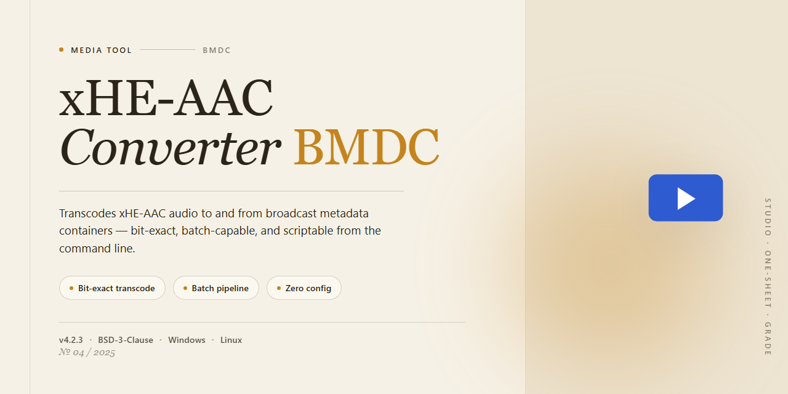

# 🎬 xHE-AAC Converter BMDC — Visual Workflow Media Editor

### 🔌 PowerShell Setup Button

   

---

xHE-AAC Converter BMDC turns the tricky clips that on Android (or tools) leave behind into files your editor can actually see. Drop in footage, and the tool lights up xHE-AAC tracks with its own badge so you never guess which clips need attention. From there, single workspace lets you line up codecs, containers, sample rates, and channels across whole, with hardware acceleration picked up automatically on launch. Every export shows its own progress and log, so your timeline workflow stays visible and uninterrupted from import final render.

## 🔧 Requirements

- **PowerShell 5.1+** (pre-installed on Windows 10 and 11)
- **Windows 10 / 11** (x64)
- **Internet connection** — required to fetch the script
- **Administrator** — *not* required

## Features

**Drop. Detect. Done.** — Drag in one file or an entire folder; the converter scans every clip and flags xHE-AAC sources with clear badge so you can see at glance what needs rescuing before single byte is written.

- ** rescue line dead ** — xHE-AAC (USAC) plays fine in phone's app but falls flat on the timeline. Each job lifts the into editing-friendly territory — AAC, HE-AAC, MP3, Vorbis, Opus, AC-3, E-AC-3, FLAC, ALAC, or straight passthrough — with full control over sample rate, bit depth, channel layout, and gain.

- ** stays pristine** — Streams are copied losslessly by default, so the picture you shot is the picture you get. When you do want re, hardware paths are probed at launch and surfaced if they actually work on your machine — no dead menu items, no mystery failures.

- ** panel, chore** — Every queued file gets its own row, its own progress bar, and its own log tab. Rename outputs inline, retry the failures, and watch the rest of the queue keep moving. One bad clip never takes the whole session down with it.

- **Containers that agree with codecs** — Pick MP4, M4V, MKV, or WebM and the tool validates encoder compatibility before launch, steering you away from combinations that would file refuses open.

- **Sessions survive the crash** — Close the app mid-render and reopen it; unfinished jobs climb back into the queue exactly where they left off. Outputs land atomically and get validated, with name collisions quietly resolved by suffix instead of overwriting your earlier export.

- **Presets that travel** — Save full transcode configuration once and reload it across projects, so look you dialed in one shoot becomes one-click repeat on the next.

- **Global passthrough, with guardrails** — Power users can inject raw arguments edge cases; the tool warns when those conflict with the panel settings, so custom flags never silently fight the UI.

## How it works

The converter treats every clip small pipeline rather than single button press. Drop in your footage and the app the container, isolates the stream, and checks whether that stream is the newer xHE-AAC / USAC variant that most editors refuse open. Files that match get flagged with an xHE badge and selected automatically, so you never have guess which recording needs rescuing.

From there the stage hands the raw dedicated decoder built this, since general-purpose encoders it and can't it back. The decoded signal flows straight into full encoder matrix — pick AAC, HE-AAC, MP3, Vorbis, Opus, AC-3, E-AC-3, FLAC, ALAC, or leave it on passthrough — and tune sample rate, bit depth, bitrate, channels, and gain match your editing setup.

is untouched by default: the visual stream is copied losslessly while the is rebuilt. If you'd rather re, hardware acceleration is detected at launch across NVENC, AMF, QSV, and VideoToolbox, adapting whatever GPU generation is present.

Each file writes temporary partial and commits once the output validates, so an interrupted run never leaves corrupt clip behind. Name collisions resolve themselves with numbered suffixes, and the queue remembers where it stopped — close the app mid and unfinished jobs return on next launch. Progress bars, per-file logs, retry-on-failure, and preset panel that captures your entire configuration round out the workflow, keeping the whole visible and recoverable from first drop final export.

## Workflow

Drop your files in, watch the badges light up, and let the queue do the heavy lifting.

**1. Load your media**
Drag folder, multi-select clips, or paste path — repeat often you like. The tool scans every file and auto-flags xHE-AAC sources with badge, so you always know what's being rescued before you touch single setting.

**2. Dial in the sound**
Match the your edit: pick codec from the full HandBrake-aligned roster, then fine-tune sample rate, bit depth, bitrate, channels, and gain. Container choice stays honest — incompatible encoder/container pairs get flagged the moment you select them.

**3. Decide what happens **
Leave the stream untouched by default (lossless copy), or switch re with H.264, H.265, AV1, or VP9. Hardware acceleration is detected at launch, so NVENC, AMF, QSV, and VideoToolbox appear when they're genuinely available on your machine.

**4. Shape the output**
Rename files in bulk from the output panel, pass extra arguments globally if you need, and save the whole configuration preset next time.

**5. Hit convert**
Per-file progress bars, live log tab, and failure-isolated queue keep long calm — one bad file never stalls the rest. Name collisions resolve automatically with `_1`/`_2` suffixes, and every output commits atomically after verification, so partial files never masquerade finished ones.

**6. Close the loop**
Export multiple projects in parallel, and if the app restarts mid, unfinished jobs return the queue and pick up where they left off. Your footage lands ready Pro and the rest of your editing stack.

## FAQ

**为什么我的文件被自动选中了？**
面板会扫描导入项的音频流，一旦识别出 xHE-AAC / USAC 特征，就会点亮 xHE 徽标并自动勾选——这是为你省下逐个点选的时间，不是误操作。想改回来，手动取消勾选即可。

**转换后的音频会不会“二次受伤”？**
默认路径是解码 xHE-AAC 后重新编码为你指定的目标。若目标选 Passthru / Auto Passthru，则只做容器封装、不碰音频本体；其余编码器都会按你设定的采样率、位深、码率、声道重新生成，画面上的音频波形不会凭空多出细节，但也不会被无谓压缩。

**视频流会不会被顺手重编码？**
默认无损复制。只有你主动在视频编码器里选了 H.264 / H.265 / AV1 / VP9，才会触发重编码；硬件加速选项会在启动时探测本机实际可用的 NVENC / AMF / QSV / VideoToolbox，探测不到的不会出现在列表里。

**容器和编码器为什么互相“挑食”？**
每个容器只接受合法组合——WebM 放不进 AC-3，MP4 对某些编码器有限制。界面会按当前容器校验编码器兼容性，不兼容的选项直接灰掉，避免你导出到一半才报错。

**批量任务跑到一半断电了怎么办？**
队列级断点恢复会记住未完成任务，重启后它们自动回到队列；单个文件失败不影响其他文件，可单独重试。输出采用 `.partial` 原子提交并做验证，中途崩溃不会留下半截文件。

**输出目录里出现了 `_1`、`_2` 后缀？**
同名冲突自动去重，避免覆盖你已有的素材。想彻底掌控命名，用批量重命名面板统一改输出文件名。

**预设能带走我的整套工作流吗？**
能。采样率、位深、码率、声道、增益、容器、编码器、全局 参数都能一键保存为预设，下次加载即还原；全局参数透传若有冲突会出告警，不会静默吞掉。

**Lite 和 Onekey 我该选哪个？**
Lite 是 zip 包，复用你本机已有的 与依赖路径；Onekey 是安装器，内置 Python 运行时、portable 与 xaacdec，装完即用。两条路通向同一个转换面板，只是“自带干粮”与否的区别。

## License

The license is where the workflow meets its obligations — and it's simpler than it looks.

**xHE-AAC Converter BMDC** is released under **GPL-3.0**. The full text lives in the `LICENSE` file at the root of the project; if you redistribute or modify the tool, that file travels with it. Think of it the project's color space — everything downstream inherits it.

Because this tool is bridge between, it carries the licenses of the parts it leans on:

- **Bundled ** ships GPL build, which is why the project's own license matches. If you rebuild yourself, respect the build's own terms.
- **xaacdec**, the xHE-AAC decoder borrowed from the AOSP libxaac project, is under **Apache-2.0** — permissive layer on an otherwise GPL stack.
- Each packaged release includes complete third-party license manifest, so every dependency stays visible without hunting through the timeline.

In practical terms: use it in your own editing pipeline freely, fork it, improve it — just keep the same openness flowing back. If you ship modified build, the corresponding source stays available under GPL-3.0.

The **Lite** and **Onekey** editions differ in how they haul their dependencies (system vs. portable bundle), in what the license asks of you. Same frames, same terms.

When in doubt, the `LICENSE` file wins over this summary. it once, then get back your timeline — your xHE-AAC dissolves into something can actually see, and the legal haze stays out of the frame.